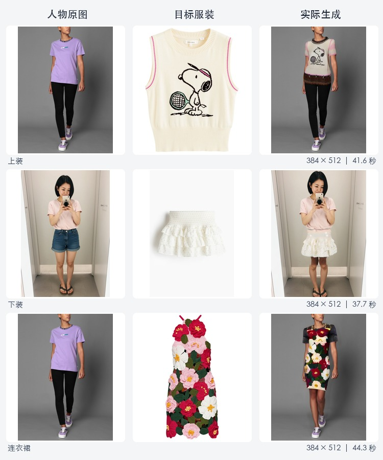

# MagicBox Try-On · 虚拟试衣间

用一张人物照和一张服装图生成上装、下装或连衣裙的试穿图。这是基于公开模型的个人工程复现。Java 21 服务负责上传校验、任务排队、重复提交处理和结果下载，Python 工作进程用 SegFormer 定位衣物，再用 CatVTON Mix 生成图像。



图中三个样例在 Apple M5 上分别用时 41.6 秒、37.7 秒和 44.3 秒，输出分辨率均为 384 × 512，使用 25 步采样。耗时取自 Java 任务开始执行到保存结果之间的记录。可以查看每次的输入哈希、模型参数与下载文件校验值。[上装记录](evidence/acceptance.json) · [下装记录](evidence/lower/acceptance.json) · [连衣裙记录](evidence/dress/acceptance.json)

## 启动

在 macOS 或 Linux 上准备 Git、JDK 21、Python 3.12 和 curl。Apple Silicon 使用已验证的完整 Python 依赖锁，Linux 使用固定版本的直接依赖。Python 路径可用 `PYTHON_BIN` 指定，JDK 路径可用 `JAVA_HOME` 指定。

```sh
git clone https://github.com/Eeeeye/magicbox-tryon.git
cd magicbox-tryon
sh scripts/setup.sh
sh scripts/run-local.sh
```

首次安装会按固定版本下载约 2.36 GB 的模型与公开样例，支持续传，并校验文件长度和哈希。此后只需运行最后一条命令，推理全程离线。看到 `Try-on ready` 后打开试衣间，选择部位，点击「使用公开样例」和「开始试穿」。生成的 PNG 可以预览、下载，也可从同一浏览器的「最近任务」重新打开。[本地试衣间](http://127.0.0.1:8780/)

也可以上传自己的 PNG 或 JPEG，每张默认上限为 5 MiB 和 1600 万像素。图片和结果保存在运行服务的机器上。Java 和模型进程分别监听本机 8780 和 8781 端口，按 Ctrl-C 可同时停止。

## 在 GPU 服务器运行

同一个项目可以部署在一台 Linux GPU 服务器上。准备 Python 3.12、JDK 21 和与 PyTorch 2.9.1 兼容的 NVIDIA 驱动。在服务器项目目录运行以下命令。第三行会执行一个 CUDA 张量运算，及时发现驱动或 PyTorch 构建不匹配。不同驱动对应的 wheel 可查安装版本表。[PyTorch 2.9.1 官方安装说明](https://pytorch.org/get-started/previous-versions/#v291)

```sh
sh scripts/setup.sh
nvidia-smi
.venv/bin/python -c 'import torch; print(torch.cuda.get_device_name(0), torch.ones(1, device="cuda").item())'
TRYON_DEVICE=cuda sh scripts/run-local.sh
```

Java 业务进程和 GPU 推理进程通过 HTTP 交换图片。想从自己的电脑打开服务器上的页面，可使用 SSH 主机别名和本地端口转发。在电脑上运行 `ssh -N -L 8782:127.0.0.1:8780 gpu-host`，再访问 [转发后的试衣间](http://127.0.0.1:8782/)。将 `gpu-host` 替换成有权限登录的主机。两端口均只在服务器的回环地址监听。

将业务和推理拆在不同机器时，可在 GPU 主机上用 `TRYON_DEVICE=cuda HF_HUB_OFFLINE=1 .venv/bin/python -m uvicorn inference.server:app --host 127.0.0.1 --port 8781` 单独启动模型，在业务机器把 GPU 端口转发到本机 18781，再用 `TRYON_MODE=catvton PORT=8780 TRYON_INFERENCE_URL=http://127.0.0.1:18781/infer/images sh scripts/run-java.sh` 启动 Java。该模式下可在业务机器使用 `ssh -N -L 18781:127.0.0.1:8781 gpu-host` 建立转发。仓库的端到端验收环境是 Apple M5 / MPS。CUDA 启动命令供有 GPU 服务器时复测。

## 推理实现

人物照按目标尺寸居中裁切。程序会识别商品平铺图的纯色边缘、裁掉多余留白，并等比缩放补白。SegFormer B2 将衣物、四肢、脸等区域分开。程序按试穿部位构造遮罩，对自然下垂的手保留末端区域。上装与下装按可编辑区域裁切后送入模型。短款下装保留原短裤下方的裸露小腿。CatVTON 将遮罩人物和目标服装的潜变量沿高度拼接，通过 SD 1.5 Inpainting U-Net 和作者公布的自注意力权重进行去噪。VAE 将人物区域解码为 RGB，最后在遮罩边界融合回原图。

默认输出 384 × 512，DDIM 25 步，guidance 2.5，seed 42。U-Net 在 MPS 使用 FP16，VAE 使用 FP32。适配 Mac 时选用了 SegFormer 自动遮罩，原作者演示使用 DensePose 和 SCHP。模型和样例文件的提交、路径与哈希在 [资产清单](inference/assets.lock.json)。[CatVTON 作者模型卡](https://huggingface.co/zhengchong/CatVTON) · [论文](https://arxiv.org/abs/2407.15886) · [服装分割模型](https://huggingface.co/mattmdjaga/segformer_b2_clothes)

| 配置 | 默认值 | 用途 |
| --- | --- | --- |
| `PORT` / `MODEL_PORT` | 8780 / 8781 | Java 服务与模型端口 |
| `TRYON_DEVICE` | auto | 按 CUDA、MPS、CPU 顺序选择可用设备 |
| `TRYON_WIDTH` / `TRYON_HEIGHT` | 384 / 512 | 单边 128 至 1024，且为 64 的倍数 |
| `TRYON_STEPS` / `TRYON_SEED` / `TRYON_GUIDANCE` | 25 / 42 / 2.5 | DDIM 步数、随机种子和引导强度 |
| `QUEUE_CAPACITY` / `INFERENCE_TIMEOUT_MS` | 4 / 600000 | 等待槽位、单个推理调用的总时限 |
| `DATA_DIR` / `MAX_TASK_HISTORY` | data/tryon / 1000 | 单实例任务目录、保留任务上限 |
| `TASK_RETENTION_SECONDS` | 604800（7 天） | 自任务成功或失败起保留输入、结果及幂等键的时长 |

## 请求和故障处理

```sh
curl -fsS http://127.0.0.1:8780/api/tryon/tasks \
  -H 'Idempotency-Key: sample-upper-001' \
  -H 'X-Garment-Category: upper' \
  -F 'person=@samples/person.jpg;type=image/jpeg' \
  -F 'garment=@samples/garment.jpg;type=image/jpeg'
```

- 提交返回 HTTP 202、任务 ID 和 `Location`。查询 `GET /api/tryon/tasks/{id}` 可得到状态、时间线、输入哈希及错误码。在 `SUCCEEDED` 后请求响应里的 `result` 可下载 PNG。
- `X-Garment-Category` 接受 `upper`、`lower` 和 `dress`。保留期内，同一幂等键配相同图片和部位会返回原任务，重启后也有效。使用同一键改换输入返回 409。
- Java 预解码两张图片，限制像素与字节数，再向模型发送带任务 ID 的 multipart。返回时检查任务 ID、两张输入的 SHA-256、MIME、响应长度上限和 PNG 可解码性，全部通过才发布图片。
- 每个模型进程一次处理一项任务。等待队列满时返回 503 和 `Retry-After`。生成超时、模型断连或与服装类别不匹配会记录失败原因。已接收任务的推理失败情况通过任务状态读取。
- 先原子提交图片，再原子更新任务状态。进程启动时恢复已完成任务，也会回收写到一半的上传。中断时已有完整结果的任务恢复成功，其余已受理的中断任务记录为 `SERVER_RESTARTED`。同一数据目录限定一个 Java 实例。
- 正在排队或推理的任务始终保留。完成任务过期后，查询任务和下载图片均返回 404，原幂等键可以提交新任务。清理时先原子移动任务目录，再删除图片和任务记录。清理中断后会在下次启动时继续。达到任务数上限时，服务先回收过期名额，仍满则返回 503。
- `GET /health/live` 报告本进程、队列和任务计数。`GET /health/ready` 同时探测模型就绪状态。默认服务监听回环地址，验收数据来自本机演示。

一次请求的主要代码入口是 [Java 任务服务](src/tryon/TryOnService.java)、[Python 推理管线](inference/engine.py) 和 [任务存储与恢复](src/tryon/TaskRepository.java)。并发重试、进程中断和保留期的可执行示例在 [接口回归测试](tests/result_contract.py)。

## 验证

快速回归可在普通 CPU 上运行。准备 JDK 21、Node.js 22 和 Python 3.12，然后执行以下命令。已运行完整安装的环境只需执行最后一行。

```sh
python3.12 -m venv .venv
.venv/bin/python -m pip install -c inference/requirements.txt numpy Pillow
sh scripts/test.sh
```

GitHub Actions 在全新 Linux 环境运行同一套测试。回归覆盖上传校验、队列满、上游超时和损坏的 PNG、相同幂等键并发、重启恢复、过期回收、前端历史记录及遮罩保护。接口回归用受控推理进程复现故障，并单独校验仓库中五张真实模型输出与各自验收记录的哈希。[自动测试](https://github.com/Eeeeye/magicbox-tryon/actions/workflows/test.yml)

真实浏览器验收使用 Playwright 1.62.1 和 Chromium。服务启动后，可在配置好 Playwright 的 Node 环境运行下列命令。现有 Chrome 可指定 `CHROME_BIN`，独立安装的 Playwright 可用 `NODE_PATH` 指定其 node_modules 路径。新环境可用 `npm install --prefix .build/browser playwright@1.62.1` 和 `.build/browser/node_modules/.bin/playwright install chromium` 安装，然后设置 `export NODE_PATH="$PWD/.build/browser/node_modules"`。

```sh
node tests/browser-e2e.cjs
TRYON_TEST_CATEGORY=lower EVIDENCE_DIR=evidence/lower node tests/browser-e2e.cjs
TRYON_TEST_CATEGORY=dress EVIDENCE_DIR=evidence/dress node tests/browser-e2e.cjs
.venv/bin/python tests/visual_acceptance.py
```

浏览器验收从点击「开始试穿」到下载 PNG，并检查下载文件与 API 响应逐字节相同，刷新后仍能重新打开。针对三个固定样例，像素检查还核对服装区域的颜色变化，以及左侧 5% 背景与原图逐像素一致。[固定样例像素检查](evidence/visual-checks.json)

在 Apple M5 上，较长的注意力序列按注意力头分片以控制峰值内存。576 × 768、25 步、guidance 3.5 的上装样例用时 93.18 秒。[高分辨率验收](evidence/high-resolution/acceptance.json)

黑色长裤换白色短裙是一次可复查的视觉失败。任务正常生成 PNG，但输出仍保留了裤型。可在浏览器选下装样例，然后把人物替换为 `samples/person.jpg` 重现这个输入组合。印花位置、袖口和下摆也会随模型生成发生变化。[困难样例结果](evidence/difficult-lower/tryon-result.png)

模型和样例的使用须遵循各自来源的许可。CatVTON 作者将模型以 CC BY-NC-SA 4.0 发布。上装、连衣裙及其人物样例来自 CatVTON 公开演示，短裙及其配套人物照来自 FASHN 的公开演示。[CatVTON 模型许可](https://huggingface.co/zhengchong/CatVTON#license) · [CatVTON 演示](https://huggingface.co/spaces/zhengchong/CatVTON) · [下装样例来源](https://huggingface.co/spaces/fashn-ai/fashn-vton-1.5/blob/c433f1268bfa86502f6582ab03494d3e4d7aa8bf/app.py)
